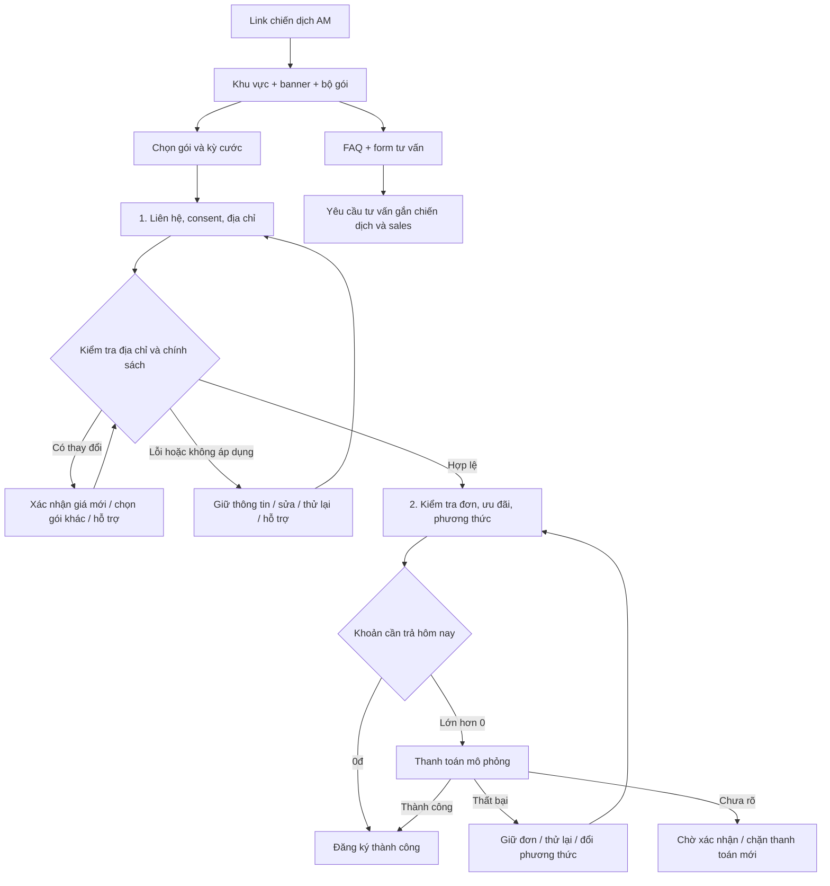

# AM v3 — Đặc tả prototype để review PO/dev

**Cập nhật trải nghiệm thử:** `index.html` hiện dùng tùy chỉnh gói trước checkout và checkout một trang. Đặc tả bên dưới giữ lại phương án nền ở `classic.html`; thay đổi cách chia màn, lý do UX và tiêu chí bổ sung được mô tả trong `EXPERIMENT-OUTSIDE.md`. Các quy tắc nghiệp vụ vẫn áp dụng cho cả hai bản.

Trạng thái: đề xuất trải nghiệm và mô phỏng nghiệp vụ, chưa phải PRD đã được phê duyệt. Tài liệu nguồn: `input/ISC_FPTVN_v2.1_PRD_Check out InternetOnly+ComboNetTH_Standard_v1.0.docx.md` và `input/Flow TO-BE checkout link AM (shop.fpt.vn).md` trong workspace.

## 1. Mục tiêu và người dùng

Khách tự vào link AM từ quảng cáo/Facebook/Zalo, khách nhận link riêng từ sales, hoặc sales hỗ trợ nhập thông tin. Chưa giả định tỷ lệ các nhóm. Mục tiêu là hiểu đúng gói và chi phí, truyền sẵn dữ liệu chiến dịch vào checkout, giữ thông tin khi khách đổi lựa chọn, có nhánh tư vấn khi chưa sẵn sàng đăng ký.

PRD fpt.vn mô tả hai màn thao tác chính: thông tin/địa chỉ và cấu hình đơn/thanh toán. Prototype tối ưu việc điền sẵn, chọn kỳ sớm và tính tiền rõ ràng; không coi mọi bước xử lý nghiệp vụ là một màn riêng để tuyên bố giảm số màn.

## 2. Hành trình được chốt

Thứ tự landing: Header → Khu vực → Banner người dùng cung cấp → Bộ gói & kỳ cước → ba thẻ EPL → FAQ → Form tư vấn → Footer. Hai nhóm đều có 3 gói mặc định và được dựng cùng một component thẻ dọc.

## 3. Ma trận cấu hình → landing

| Cấu hình chiến dịch | Dữ liệu mô phỏng | Hiển thị / tác động | Mức xác nhận |
|---|---|---|---|
| Sản phẩm & Dịch vụ: Tỉnh/TP, Phường/Xã | `region` | Thanh khu vực, giá khu vực, điền sẵn checkout | Có trong ảnh cấu hình |
| Bật/tắt nhóm Internet/Combo | `sections.*.visible` | Ẩn cả nhóm và tab tương ứng | Có trong ảnh cấu hình |
| Danh sách/thứ tự gói | `sections.*.planIds` | Thẻ gói theo đúng thứ tự, tối đa 3 mỗi nhóm | Có trong ảnh cấu hình |
| Banner | `banner` | Ảnh chính; CTA đặt ngoài ảnh | Có tab Banner; schema ảnh/CTA cần xác nhận |
| Thông tin ưu đãi | `promotions` | Ba thẻ EPL có ảnh, nhãn, mô tả, CTA | Có tab Ưu đãi; cấu trúc ba thẻ là đề xuất |
| Câu hỏi thường gặp | `faqs` | Accordion dưới khối quảng bá | Có tab FAQ; trường chi tiết cần xác nhận |
| Thông tin liên hệ | `sales`, `contact` | Người hỗ trợ, nội dung tư vấn, chính sách | Có tab Liên hệ; cách gắn sales cần xác nhận |
| Gói gợi ý | `recommended` | Nhãn gợi ý và nút chính trên một thẻ | Đề xuất; chưa xác nhận là trường quản trị |
| Campaign ID | `id` | Gắn nguồn lead/đơn mẫu | Dữ liệu mô phỏng; mã thật do hệ thống xác định |

Không xây trang quản trị mới. `campaign.js` là fixture phục vụ review, không tuyên bố đây là hợp đồng API hiện hữu.

## 4. Quy tắc nghiệp vụ

| ID | Quy tắc | Nguồn / trạng thái |
|---|---|---|
| AM-01 | Giá và khả dụng phải được xác nhận theo địa chỉ trước thanh toán. Chọn khu vực không đồng nghĩa đã có vùng phủ. | PRD US01/FR01 |
| AM-02 | Cho chọn trả sau, 3/6/12 tháng trên landing; mặc định trả sau. Cước tháng và khoản trả ban đầu là hai số riêng. | Người dùng đã chốt; đặt sớm là đề xuất UX |
| AM-03 | Gói/kỳ/khu vực được giữ sang checkout. Khách sửa được; không thêm giỏ hàng độc lập. | Người dùng đã chốt |
| AM-04 | Họ tên, SĐT hợp lệ và consent mới tạo lead nháp mẫu; mã chiến dịch/sales gắn theo link. | TO-BE; API tạo lead sớm còn cần PO/backend |
| AM-05 | Đổi địa chỉ giữ liên hệ, kỳ, gói; báo giá mới khác giá đã chấp nhận thì chặn tiếp tục đến khi xác nhận. | PRD US01 + TO-BE |
| AM-06 | Đổi gói/kỳ phải kiểm tra thiết bị, voucher, phương thức. Nếu mất lựa chọn, hỏi xác nhận; hủy phải giữ lựa chọn cũ. | PRD US05/FR02 |
| AM-07 | Thiết bị chỉ hiển thị nếu hợp lệ; không ghép Camera hoặc dịch vụ ngoài Internet/Combo Net–TH. | PRD scope/US06 |
| AM-08 | Đổi gói, kỳ, thiết bị hoặc phương thức gây tính lại bất đồng bộ. Chặn thanh toán trong lúc tính lại; kết quả cũ không được ghi đè lựa chọn mới. | PRD US10 |
| AM-09 | Auto-apply voucher theo ưu tiên hình thức, rồi giá trị trong cùng hình thức; cho chọn thủ công. Không gọi đây là mức tiết kiệm lớn nhất tuyệt đối. | PRD US08/FR06 |
| AM-10 | Voucher phải hợp lệ theo kỳ, phí, ngưỡng đơn và phương thức. Giảm phí lắp đặt không vượt phí lắp đặt. Tổng không âm. | PRD US07–09; cap phí là giả định mẫu |
| AM-11 | Trả sau vẫn xem đầy đủ đơn; có phí đầu kỳ thì thu. Đơn 0đ xác nhận trực tiếp, không mở cổng thanh toán. | PRD US08 + quyết định plan |
| AM-12 | Thanh toán lỗi giữ cùng mã đơn; thử lại tạo lần giao dịch mới. Pending không có nút trả lại lần nữa. | TO-BE |
| AM-13 | Form tư vấn là nhánh riêng; cần tên, SĐT, consent; đang gửi/sent không gửi lặp; giữ nguồn campaign/sales/khu vực. | Quyết định plan |

### Tính tiền mẫu

`Cần trả hôm nay = cước trả trước + phí lắp đặt + thiết bị thêm − giảm giá`, tối thiểu 0đ. Cước trả trước bằng cước tháng × số tháng thanh toán. Mẫu không có tháng tặng; trả 3/6/12 tháng tương ứng sử dụng 3/6/12 tháng.

Tổng thật phải lấy từ backend, không sử dụng phép tính frontend này làm nguồn quyết định giao dịch thực tế.

### Giả định mẫu được dùng để kiểm thử

- Giá gói lấy từ catalog cũ trong workspace, không phải bảng giá AM đã duyệt. HCM delta 0; Hà Nội −10.000đ/tháng; Đà Nẵng +20.000đ/tháng.
- Trả sau: 300.000đ phí lắp đặt, chưa thu cước tháng; trả trước: phí lắp đặt 0đ. Chưa có giảm giá cước tháng theo kỳ.
- Mesh 350.000đ mua một lần, mọi gói được chọn. Thiết bị giải trí 650.000đ chỉ cho Combo trả trước. Không tự khẳng định thiết bị sản xuất thực tế có rule này.
- Mẫu không hỗ trợ thẻ quốc tế ở kỳ trả sau để thử đổi phương thức phụ thuộc chính sách.
- `UUDAI50`: giảm phí lắp đặt 50.000đ. `UUDAI100`: trả trước ≥3 tháng, đơn ≥600.000đ, chỉ VNPAY/chuyển khoản/ATM. `UUDAI150`: trả trước ≥6 tháng. `HETHAN`: không chọn được. `DON0`: chỉ dùng kịch bản kiểm thử 0đ.
- Thứ tự hình thức mẫu: giảm tiền trực tiếp trước giảm phí lắp đặt; trong cùng hình thức chọn giá trị giảm cao hơn. Một voucher tại một thời điểm.
- Nhánh gửi đăng ký thanh toán sau ở màn lỗi vẫn ghi rõ là đề xuất chờ PO. Không tự coi đây là khả năng đã được hệ thống cho phép.
- Lead, quote, đơn và giao dịch chỉ nằm trong bộ nhớ; reload mất phiên. Không có dữ liệu cá nhân trên URL.

## 5. Ngoại lệ và tiêu chí nghiệm thu

- Link không có khu vực: hiện giá “Từ”, yêu cầu chọn khu vực trước khi mở checkout.
- Nhóm tắt hoặc không có gói: không hiển thị tab/nhóm đó; toàn bộ rỗng có lối nhận tư vấn.
- Gói không áp dụng: gợi ý gói khác trong bộ chiến dịch, không tự đổi thay khách. Không có gói: sửa địa chỉ hoặc nhờ hỗ trợ.
- Kiểm tra địa chỉ lỗi: giữ dữ liệu, cho thử lại bằng nút kiểm tra; không cho thanh toán bằng quote chưa hợp lệ.
- Quay lại trang gói hoặc sửa thông tin không mất dữ liệu trong phiên. Đổi loại nhà giữ liên hệ nhưng yêu cầu nhập đúng thông tin chi tiết cho loại mới.
- Mobile 375px, tablet 768px, desktop 1440px không cuộn ngang; banner nguyên ảnh và CTA không che chữ; nút thanh toán trong chiều rộng màn hình.
- Tất cả ảnh được tải cục bộ. FAQ dùng keyboard được; lỗi input có nhãn/aria và focus vào trường cần sửa.
- Kịch bản kiểm thử và ảnh nằm trong `qa/results.txt` và thư mục `qa/`.

## 6. Điểm cần PO/backend xác nhận trước triển khai thật

1. Bảng giá AM theo địa bàn, loại nhà và từng biến thể kỳ cước; product code có thay đổi theo kỳ không?
2. Tháng thanh toán/tháng sử dụng/tháng tặng, phí ban đầu, VAT và chính sách thiết bị thực tế.
3. API kiểm tra hạ tầng, báo giá và thời hạn hiệu lực báo giá; xử lý gói hết hiệu lực khi thanh toán.
4. API lưu lead sớm; cách ghi nhận nguồn chiến dịch/sales và consent; chống trùng với form tư vấn.
5. Thiết bị bắt buộc, min/max số lượng, addon và phương thức được hỗ trợ theo gói/địa bàn.
6. Công thức ưu tiên voucher thật; hỗ trợ kết hợp hay loại trừ; điều kiện đã chọn thủ công khi đơn thay đổi.
7. Thời điểm tạo đơn so với thanh toán: PRD fpt.vn tạo sau thành công, TO-BE AM đề xuất giữ đơn trước thanh toán. Prototype chọn mã đơn nháp trước giao dịch để minh họa phục hồi, chưa chốt kiến trúc thật.
8. Trả sau có phí cần thu ngay không; có được tạo đơn chưa thanh toán/COD; nhánh thanh toán sau có được phép không?
9. Chính sách hoàn tiền, pending, webhook và chống giao dịch trùng.
10. Schema chi tiết các tab Banner/Ưu đãi/FAQ/Liên hệ; nội dung EPL, quyền lợi và ảnh nào được phép xuất bản chính thức.
11. Chỉ số đo: xem chiến dịch, đổi khu vực/kỳ, chọn gói, bắt đầu checkout, hoàn tất, gửi tư vấn. Prototype chưa gửi analytics thật.
